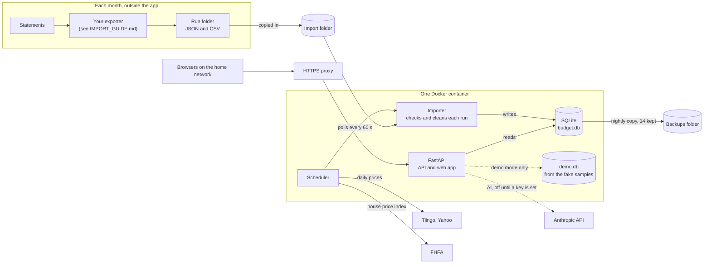

# Run your own copy

How to run the app: what to install, what hardware it needs, and the steps. One Mac, Windows or Linux machine is enough. A home server is optional.

## How it works



- One process serves the API and the web app, and runs a small scheduler: imports, backups, prices, the house price index and the AI review.
- All data lives in one SQLite file. Backups are copies of that file.
- The app never reads bank sites. It imports run folders in the format in `schema/README.md`.
- Outbound calls: prices (Tiingo, with Yahoo as the fallback), the FHFA house price index file, and Claude only when an Anthropic key is set.

## Pick a way

| Way | Good for | You need |
|---|---|---|
| 1. Try it with fake data | A first look, or changing the code | git, uv and Node 24. No Docker. |
| 2. One machine with Docker | Real use on one laptop or desktop | Docker and a small HTTPS proxy (Caddy) |
| 3. Home server | Real use for the whole household, phones included | A Linux server with Docker, a reverse proxy with a real certificate, and a name on the home network's DNS |

Ways 2 and 3 run the same image. Way 3 only adds a server that stays on, a proper certificate and a DNS name.

## Software

| | Mac, Apple silicon | Mac, Intel | Windows 10 or 11 | Linux, x86-64 or arm64 |
|---|---|---|---|---|
| Way 1 | git, uv, Node 24 (`brew install uv node@24`) | Same, plus Xcode Command Line Tools (one package builds from source). Put Node 24 on PATH yourself (the scripts only add the Apple silicon Homebrew path). | Use WSL2 with Ubuntu and follow the Linux column. Native Windows does not work: the importer uses file calls Windows does not have. | git, uv, Node 24 (nvm, fnm or NodeSource) |
| Ways 2 and 3 | OrbStack or Docker Desktop, plus Caddy | Docker Desktop or OrbStack, plus Caddy | Docker Desktop (WSL2 backend), plus Caddy | Docker Engine 23 or newer, plus Caddy or another reverse proxy |

- uv installs Python 3.14 by itself. The Docker build uses its own Node to build the web app, and the image ships its own Python.
- On Windows, clone inside WSL2, or with `git clone -c core.autocrlf=false`. Windows line endings change the sample files, and their checksums then fail.
- Optional: Google Chrome or another Chromium browser for `scripts/screenshot.mjs`.

## Hardware

| | What it needs |
|---|---|
| The app | About 150 MB of RAM and 2% of one CPU core when idle, the same with demo mode on. Healthy about 3 seconds after start. Any Mac or PC from the last several years is plenty. |
| Disk | Image about 230 to 270 MB. Database 1.4 MB with the fake household; a real one grows each month, and the backups keep 14 nightly copies. Leave a few GB for Docker and its build cache. Way 1 needs about 0.5 GB for the Python and Node packages. |
| A server (way 3) | Any x86-64 or arm64 mini PC, NAS or server that runs Docker, with 1 GB of free RAM. 32-bit ARM is not supported. |
| Phones and laptops | Any current browser. The app is meant for the home network only. |

Measured Oct 30, 2026, on the release image with the fake household.

## Way 1: try it with fake data

```
git clone <this repo's URL> household-budget
cd household-budget
scripts/dev.sh
```

In a second terminal, make a user:

```
cd backend
UV_FROZEN=1 uv run python -m app.cli create-user <name> --display-name <Name> --admin
```

Open `http://localhost:5173` and sign in. The app imports the fake household from `samples/` within a minute. Ctrl-C stops it. Everything it writes stays in `var/`, which git ignores. To see demo mode: Settings, Demo mode, Start demo.

Run `scripts/check.sh` before any commit. It runs every test and check.

## Way 2: one machine with Docker

Tested Oct 30, 2026, on an Apple silicon Mac with OrbStack. Run these from the repo folder.

1. Build the image. It builds for the machine's own chip:
   ```
   docker build -t budget-app:local .
   ```
2. Make four folders. The fake household goes in the import folder for a first look:
   ```
   B="$HOME/budget"
   mkdir -p "$B/db" "$B/backups" "$B/import" "$B/config"
   chmod 700 "$B/db" "$B/backups"
   cp -R samples/data/. "$B/import/"
   cp samples/private_rules.example.json "$B/config/private_rules.json"
   ```
   On Linux, also run `sudo chown -R 99:100 "$B/db" "$B/backups"`. The app runs as user 99 and writes only there.
3. Write the settings file. `docs/budget.env.example` explains every setting:
   ```
   cat > "$B/budget.env" <<'EOF'
   TZ=America/Chicago
   BUDGET_ALLOWED_HOSTS=localhost
   BUDGET_PUBLIC_PORT=8443
   BUDGET_PRIVATE_RULES=/data/config/private_rules.json
   TIINGO_API_KEY=
   ANTHROPIC_API_KEY=
   EOF
   chmod 600 "$B/budget.env"
   ```
   Empty keys turn their features off. Add a Tiingo key for daily prices and an Anthropic key for the AI features, only in this file.
4. Start it:
   ```
   docker run -d --name budget-app --restart unless-stopped \
     -v "$B/db:/data/db" -v "$B/backups:/data/backups" \
     -v "$B/import:/data/import:ro" -v "$B/config:/data/config:ro" \
     --env-file "$B/budget.env" -p 127.0.0.1:8710:8000 \
     --log-driver json-file --log-opt max-size=10m --log-opt max-file=3 \
     budget-app:local
   curl -s http://127.0.0.1:8710/healthz
   ```
   The last line prints `{"ok":true,"db":"ok"}` after a few seconds.
5. Make a user (it asks for the password):
   ```
   docker exec -it budget-app /app/.venv/bin/python -m app.cli create-user <name> --display-name <Name> --admin
   ```
6. Put HTTPS in front, in a second terminal:
   ```
   caddy reverse-proxy --from localhost:8443 --to 127.0.0.1:8710
   ```
   Caddy makes a certificate for `localhost` and asks once to trust it. Then open `https://localhost:8443` and sign in.

Why HTTPS: sign-in uses a Secure cookie and checks that each change comes from an `https://` page on an allowed host. Plain `http://localhost:8710` shows the sign-in page but refuses the sign-in ("Request origin not allowed."). The app side was tested with a small HTTPS proxy in place of Caddy; Caddy itself was not run in the test.

A laptop that sleeps is fine. A missed nightly backup runs at the next check after it wakes. Stop the app with `docker stop budget-app` and start it again with `docker start budget-app`.

### Start real use with empty folders

Step 2 loads a fake household. Real imports don't remove it, so fake and real money would mix. When you're ready for your own data, start over: remove the container with `docker rm -f budget-app`, delete `$B/db`, `$B/backups` and `$B/import`, make them again as in step 2 and skip the two `cp` lines. Then repeat steps 4 and 5. To look at the fake household later, use Settings, Demo mode. It keeps its data apart from yours.

## Way 3: a home server

The same image and steps as way 2, on a server that stays on:

- Set `BUDGET_ALLOWED_HOSTS` to the app's name on the home network (for example `budget.home.example`) and `BUDGET_PUBLIC_PORT` to the proxy's HTTPS port (leave it out for 443).
- Put a reverse proxy with a certificate the household's devices trust in front (Nginx Proxy Manager, Caddy or Traefik), limited to the home network.
- Add the name to the home network's DNS so phones find it.


## Feed it real data

The app needs monthly run folders in the import format (`schema/README.md`). [IMPORT_GUIDE.md](IMPORT_GUIDE.md) shows how to make them from your own statements. `schema/check_run.py` checks a run before it goes in. Drop each run folder in the import folder; the app imports it within a minute.

Without real runs, everything can still be explored with the fake household or demo mode.

## Privacy rescan

The private rules file (`BUDGET_PRIVATE_RULES`) lists your employer's name and any subscriptions you'd rather not name. The app checks stored text again at start when that file changes. To run it now, and add `--dry-run` to only list matches:

```
docker exec -it budget-app /app/.venv/bin/python -m app.cli privacy-rescan [--dry-run]
```

A match is masked in the database, but not in your older copies. If the output names run folders or backups that still hold the text, delete those folders and those backups yourself.

If it says `Purge these runs`, a key holds the text, so masking can't fix it. Preview with `app.cli purge-run <run_id>`, then add `--yes` to purge that run.

## Make it yours

A few things are set in the code. Change them in your copy:

- **Household name:** `frontend/src/lib/demo.ts` (`REAL_BRAND`) and `frontend/src/features/auth/LoginPage.tsx`.
- **Time zone:** America/Chicago, in `backend/app/config.py`. It sets "today" and "this month".
- **Home value estimates:** one metro area's FHFA index, Austin, TX by default, in `backend/app/valuations/hpi.py`. Use your own metro's place id and state.
- **Categories and their emoji:** `schema/categories.json`.

## What was tested

| | Status (Oct 30, 2026) |
|---|---|
| Way 1 on an Apple silicon Mac | Works |
| The checks on Ubuntu (x86-64) | Run by CI on every pull request |
| The image on an x86-64 Linux server | Runs |
| Way 2: the x86-64 release image on an Apple silicon Mac with OrbStack, behind an HTTPS proxy: sign in, Dashboard, Accounts, demo mode | Works |
| A native arm64 build on an Apple silicon Mac | Builds and starts healthy |
| The image at plain `http://localhost` | Sign-in refused, as designed |
| Intel Mac, Docker Desktop, Windows (WSL2), Linux outside CI, Raspberry Pi, Caddy itself | Not tested |

